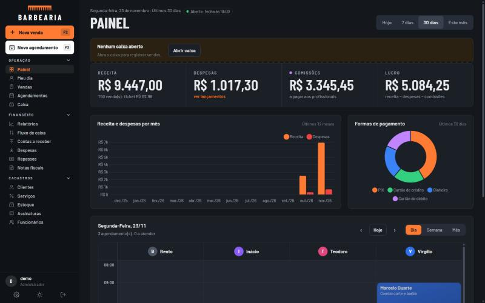
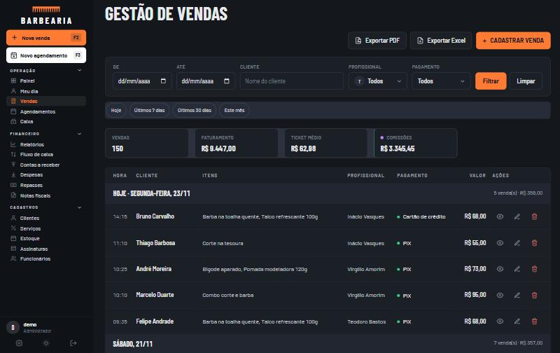
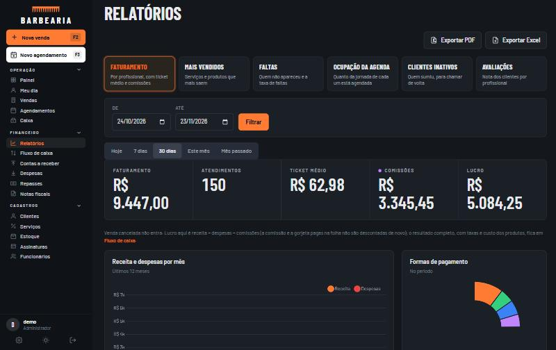

# Sistema de gestão para barbearia — demonstração

ERP de um negócio de serviços sob agendamento: atendimentos, vendas,
agenda, estoque, caixa, comissões e financeiro. Blazor Server sobre
.NET 9 e MySQL 8, sem ORM.



> **Esta é uma cópia de demonstração.** Ela não carrega a marca, os
> dados nem a configuração de nenhum cliente. Todo o conteúdo que
> aparece nas telas é gerado por um comando de dados de exemplo:
> profissionais, serviços, produtos, clientes e movimento são
> inventados.

## Rodando

Com Docker, em dois comandos:

```bash
cp .env.example .env    # troque as senhas antes de subir
docker compose up --build
```

O sistema fica em <http://localhost:8080>, e entra com `admin` /
`demo1234` -- o acesso de demonstracao, que tambem aparece escrito na
propria tela de entrada. Para usar outro, defina `ADMIN_USUARIO` e
`ADMIN_SENHA` no `.env` antes da primeira subida.

Para encher as telas com movimento:

```bash
docker compose run --rm app dotnet Barbearia.dll --dados-exemplo
```

E para desfazer:

```bash
docker compose run --rm app dotnet Barbearia.dll --remover-exemplo
```

### Sem Docker

Precisa de .NET 9 e de um MySQL 8 à mão:

```bash
export ConnectionStrings__MySqlConnection="Server=127.0.0.1;Port=3306;Database=barbearia;User=root;Password=SUA_SENHA"
export ADMIN_USUARIO="admin" ADMIN_SENHA="uma-senha-forte"
dotnet run --project Barbearia
```

O banco é criado e migrado na subida: não há script para rodar à mão.

## O que tem dentro

| Área | O que faz |
| --- | --- |
| Operação | Venda com itens, desconto, gorjeta e pagamento dividido; agenda com conflito de horário e lista de espera; caixa com abertura, sangria e fechamento conferido |
| Financeiro | Fluxo de caixa, contas a receber (fiado), despesas, comissões por profissional, folha de pagamento e emissão de NFS-e |
| Cadastros | Clientes, serviços, produtos com estoque, planos e assinaturas, profissionais e fornecedores |
| Gestão | Painel com indicadores, relatórios gerenciais e exportação em PDF e planilha |
| Acesso | Equipe, funções, matriz de permissões por tela e ação, e auditoria |



## Decisões que valem olhar

**Controle de acesso num catálogo só.** As telas e as ações vivem em
[`Configs/Catalogo.cs`](Barbearia/Configs/Catalogo.cs); as políticas de
autorização são criadas em tempo de execução a partir dele, em vez de
registradas uma a uma. Uma tela nova entra no catálogo e já nasce
protegida — inclusive os endpoints de exportação, que caem numa regra
que exige a permissão correspondente à rota. O desenho está descrito em
[docs/EQUIPE-E-ACESSOS.md](docs/EQUIPE-E-ACESSOS.md).

**Autenticação própria.** Senha com hash derivado por PBKDF2, sessões
revogáveis por dispositivo, bloqueio por tentativas falhas e troca
obrigatória quando um administrador redefine a senha de alguém.

O acesso `admin` / `demo1234` existe só nesta cópia, para ela abrir sem
configuração. No sistema de origem não há acesso padrão: sem
`ADMIN_USUARIO` e `ADMIN_SENHA` ele sobe sem nenhum usuário.

**Banco sem ORM.** SQL escrito à mão sobre ADO.NET, uma classe de
acesso por assunto. As migrações são idempotentes e rodam na subida,
conferindo o `information_schema` antes de alterar.

**Estoque em transação.** Toda mudança de saldo passa pelo mesmo ponto,
que trava a linha do produto, grava o movimento com o saldo resultante
e só então confirma. Venda, compra, consumo interno, perda e inventário
entram pelo mesmo caminho.

**PDF e planilha sem biblioteca.** Os dois geradores são escritos no
projeto. A única dependência externa é o driver do MySQL.



## Testes

242 testes, em xUnit, contra um MySQL de verdade — não contra uma
imitação. Eles só rodam com a variável apontando para um banco
descartável:

```bash
export BARBEARIA_TESTE_CONEXAO="Server=127.0.0.1;Port=3306;Database=barbearia_teste;User=root;Password=SUA_SENHA"
dotnet test Barbearia.Tests
```

Suba a aplicação uma vez contra esse banco antes, para as migrações
criarem o esquema. Sem a variável os testes são ignorados e o
`dotnet test` passa numa máquina sem MySQL.

## Aviso

Demonstração para portfólio. Para colocar algo assim no ar faltam
coisas que ficaram de fora de propósito: TLS, backup, limite de
requisições e uma revisão de segurança da hospedagem escolhida.
